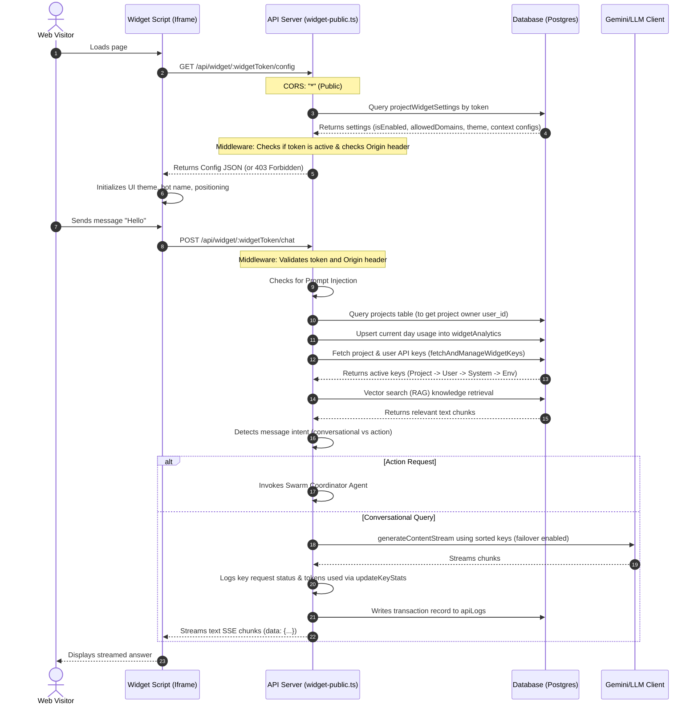

# Technical Audit & Architecture Report: Subscription & Trial System

This report provides a detailed analysis of the current implementation of **Widget Studio**'s codebase to support the design and architecting of a subscription and trial system, specifically focusing on the "Allowed Domain" security feature.

---

## 1. Current Authentication & User Structure

### Authentication Provider(s)
* **Provider:** Supabase Auth (via `@supabase/supabase-js`).
* **Implementation File:** [supabaseAuth.ts](file:///d:/Project/Chat-bot/backend/api-server/src/middlewares/supabaseAuth.ts)
* **Mechanism:** The backend verifies JWT tokens sent in the `Authorization` header (`Bearer <token>`) using `supabase.auth.getUser(token)` via the Supabase Service Role Key (or anonymous key fallback).
* **Local Development Mode:** If `process.env.LOCAL_DEMO_MODE === "true"`, authentication is bypassed, automatically seeding and utilizing a hardcoded demo user:
  * **User ID:** `"00000000-0000-4000-8000-000000000001"`
  * **Email:** `"local-demo@example.com"`
  * **Workspace Name:** `"Demo Workspace"`
  * **Subscription Status:** `"active"`

### User Table & Schema
Defined in [src/schema/index.ts](file:///d:/Project/Chat-bot/database/db/src/schema/index.ts#L33-L43):
```typescript
export const users = pgTable("users", {
  id: uuid("id").primaryKey().defaultRandom(),
  email: text("email").notNull().unique(),
  role: varchar("role", { length: 50 }).default("user").notNull(), // super_admin, admin, user, client
  features: jsonb("features").$type<{
    canCreateProject: boolean;
    canUseWidgetStudio: boolean;
    canUseContextEngine: boolean;
  }>().default({ canCreateProject: true, canUseWidgetStudio: false, canUseContextEngine: false }).notNull(),
  createdAt: timestamp("created_at").defaultNow().notNull(),
});
```

### User Identification Mappings
* The Supabase User ID (`data.user.id`) maps directly to `users.id` upon the first successful login.
* **Special Co-owner Bypass:** In [supabaseAuth.ts](file:///d:/Project/Chat-bot/backend/api-server/src/middlewares/supabaseAuth.ts#L120-L132), the email `rakesh0837m@gmail.com` maps directly to the database ID of `rakesh837m@gmail.com`. Both are assigned the `super_admin` role.
* The resolved User ID is attached to `req.auth.userId` and is used to scope queries downstream.

### Project Ownership & Workspace Context
Projects are linked to users and workspaces via:
1. `projects.userId` referencing `users.id`.
2. `projects.organizationId` referencing `organizations.id`.
3. If a user logs in and does not have an organization membership, a default workspace (`${email}'s Workspace`) is automatically generated with `planId: "00000000-0000-0000-0000-000000000001"` and `subscriptionStatus: "active"`, and the user is registered as the `"owner"`.
4. Role permissions within workspaces are enforced via [authorizeMembership.ts](file:///d:/Project/Chat-bot/backend/api-server/src/middlewares/authorizeMembership.ts).

### Roles & Admin System
* **Platform Roles (`users.role`):** `"super_admin"`, `"admin"`, `"user"`, `"client"`.
  * `super_admin` automatically bypasses all workspace-level checks.
* **Workspace Roles (`organizationMembers.role`):** `"owner"`, `"admin"`, `"manager"`, `"agent"`, `"viewer"`.
  * Roles carry numerical weights: `owner` (5), `admin` (4), `manager` (3), `agent` (2), `viewer` (1).
* **Multi-Project Support:** Yes. The relationships permit a user to belong to multiple organizations and create multiple projects within each organization.

---

## 2. Current Project & Allowed Domain Structure

### Database Tables & Fields
There are two fields in the database named `allowed_domains`:
1. **`projects.allowedDomains`** in [src/schema/index.ts](file:///d:/Project/Chat-bot/database/db/src/schema/index.ts#L142):
   * **Field:** `allowedDomains: jsonb("allowed_domains").$type<string[]>().default(["*"]).notNull()`
   * **Status:** **Dead column.** This column is never updated, read, or enforced in the backend or frontend app code.
2. **`projectWidgetSettings.allowedDomains`** in [src/schema/index.ts](file:///d:/Project/Chat-bot/database/db/src/schema/index.ts#L396):
   * **Field:** `allowedDomains: jsonb("allowed_domains").$type<string[]>().default([]).notNull()`
   * **Status:** **Active column.** This is the actual field modified in Widget Studio and enforced on backend widget requests.

### Configuration Scope
* **Domain Limit:** Supports multiple allowed domains since it is stored as a `string[]` JSONB array.

### Domain Validation Mechanism
Implemented in [widget-public.ts](file:///d:/Project/Chat-bot/backend/api-server/src/routes/widget-public.ts#L488-L536):
* Validation is performed **entirely on the backend** through Express middleware.
* The system retrieves the `Origin` header from the request (`req.headers.origin`).
* If `origin` is present, not `"null"`, and the array `settings.allowedDomains` is not empty (length > 0):
  1. Each domain in `settings.allowedDomains` is converted to a hostname string (e.g. `example.com`), prefixing with `https://` if it does not begin with `http` to allow parsing.
  2. The hostname of the `origin` header is extracted.
  3. It verifies: `if (!allowedUrls.includes(requestHostname))`
* **Empty/Wildcard Allowed Domains:** If `allowedDomains` is empty (length `0`), the validation block is skipped completely, allowing requests from **any domain** (unrestricted access).
* **Development/Localhost Handling:** There is no special treatment for `localhost` or development environments on the backend. If the allowed domains list has items, local origins (e.g., `http://localhost:3000`) will be blocked unless explicitly added to the allowed domains list.
* **Failure Responses:**
  * If the host does not match: returns `403 Forbidden` with `{ error: "Domain not authorized" }`.
  - If the origin header is malformed and fails parsing: returns `403 Forbidden` with `{ error: "Invalid origin" }`.

---

## 3. Current Subscription / Payment System

> [!NOTE]
> The codebase has an partial database schema and a manual review workflow, but **there is no automated billing integration, and subscription limits are not enforced in the runtime chatbot API.**

### 1. Payment System Details
There is a manual billing system for activating project licenses:
* **Route File:** [payments/index.ts](file:///d:/Project/Chat-bot/backend/api-server/src/routes/payments/index.ts)
* **Price:** ₹499 in paise (`49900` paise) represented by `DEPLOYMENT_PRICE_PAISE`.
* **Submission Flow:** The user initiates a manual UPI transfer to a configured UPI ID (stored in `globalSettings.PAYMENT_UPI_ID`, default: `rakesh837m@okaxis`). They then submit the screenshot and UTR transaction ID via the `/api/payments/manual` endpoint.
* **Approval Flow:** A platform administrator approves/rejects payments manually via the admin panel.

### 2. Database Schema
* **`plans` table:** Defines plans (`id`, `name`, `price`, `currency`, `interval`, `features`).
* **`projectLicenses` table:** Maps a project to a plan, tracking `licenseStatus` (`active`, `inactive`) and `paymentStatus` (`pending`, `paid`, `failed`).
* **`payments` and `paymentLogs` tables:** Tracks UPI payments and the admin verification trail.
* **`organizations` table:** Contains Stripe/Razorpay fields:
  * `stripeCustomerId`, `razorpayCustomerId`, `subscriptionId`, `subscriptionStatus` (default: `"inactive"`), `trialStartedAt`, `trialEndedAt`.

### 3. Payment Integrations
* **Stripe & Razorpay status:** **Not integrated.** While the database columns exist, there is no code that imports Stripe or Razorpay SDKs, generates checkout sessions, or processes webhooks. (Indeed, a migration `0006_manual_payments.sql` explicitly removed the original `razorpay_order_id` columns from the payments table).
* **Webhook support:** **None.** There are no webhook receiver endpoints for Stripe or Razorpay in the API server.

### 4. Verification & Backend Enforcement
* **How payment success is verified:** Verified manually by an administrator using `POST /api/super-admin/payments/:id/approve` or `POST /api/super-admin/payments/:id/reject`.
* **Licensing Backend Check:** **None.** Unpaid projects are NOT blocked from loading or serving chat responses in the widget. The backend API `/api/widget/:widgetToken/chat` does not check the `projectLicenses` table.
* **Frontend Bypassing:** The payment verification view in the dashboard is completely bypassed in [admin-project-edit.tsx](file:///d:/Project/Chat-bot/frontend/chat-app/src/pages/admin-project-edit.tsx#L700-L701):
  ```typescript
  // Payment feature temporarily disabled - allow deployment directly for all users
  return <Deployment projectId={projectId} />;
  ```
* **Enforced Limits:** Feature limits (such as token caps, message quotas, or storage constraints) are not enforced in the message-routing logic.

---

## 4. Current Widget Access Flow

The runtime flow when an end-user visits a website hosting the chatbot widget:



### Validation points
1. **Middleware Check:** Checks that the widget is enabled (`isEnabled === true`) and matches the request domain (if `allowedDomains` is populated).
2. **Security Check:** Blocks malicious inputs using a prompt injection regex (`detectPromptInjection`).
3. **API Key Check:** Filters available keys to ensure they are healthy. If no healthy keys remain, the chat terminates early with a user-facing instruction to configure API keys.

---

## 5. Current API / AI Usage System

* **Usage Tracking:** AI requests are logged in the `apiLogs` table, linking each request to a `userId` (if a user API key is used) and/or `projectId` (if a project API key is used).
* **Analytics Accumulation:** Widget interactions aggregate metrics in the `widgetAnalytics` table daily, scoped by `projectId` (tracking visitor counts, messages, and estimated costs/tokens).
* **Feature Flags:** Flags in `users.features` (`canUseWidgetStudio`, `canUseContextEngine`) are defined but are only enforced inside frontend dashboard views.
* **Chat Route Processing:**
  * Public widget chat: `POST /api/widget/:widgetToken/chat`
  * Dashboard direct chat: `POST /gemini/conversations/:id/messages`
* **Subscription/Trial Validation Point:** To prevent expired workspaces/projects from consuming AI resources, the billing check must be implemented in the backend:
  * In the widget middleware in [widget-public.ts](file:///d:/Project/Chat-bot/backend/api-server/src/routes/widget-public.ts#L488) (covering both `/config` and `/chat`).
  * In the private chat router in [gemini/index.ts](file:///d:/Project/Chat-bot/backend/api-server/src/routes/gemini/index.ts#L500).

---

## 6. Database Relationships

Below is the database relationship structure for resources tied to users, projects, and billing:

```
User
 ├── Connected Services (user_id FK)
 │
 ├── User API Keys (user_id FK)
 │
 ├── Organization Members (user_id FK)
 │    └── Organizations (organization_id FK)
 │         ├── Project (organization_id FK)
 │         │    ├── Project Widget Settings (projectId PK/FK)
 │         │    ├── Project Context Settings (projectId PK/FK)
 │         │    ├── Project API Keys (project_id FK)
 │         │    ├── Project Licenses (project_id FK)
 │         │    │    └── Plans (plan_id FK)
 │         │    ├── Payments (project_id & organization_id FK)
 │         │    │    └── Payment Logs (payment_id FK)
 │         │    ├── Chat Sessions (project_id & user_id FK)
 │         │    │    └── Messages (session_id FK)
 │         │    ├── Widget Analytics (project_id FK)
 │         │    ├── Widget Leads (project_id FK)
 │         │    ├── Notes (project_id FK)
 │         │    └── Knowledge Categories (project_id FK)
 │         │         └── Knowledge Sources (category_id FK)
 │         │              └── Knowledge Chunks (knowledge_source_id FK)
 │         │
 │         └── Organization Usage (organization_id FK)
 │
 └── Audit Logs (user_id FK)
```

### Table Definitions & Keys (Drizzle schema)

| Table Name | Primary Key | Foreign Keys / Relationships | Unique Constraints / Indices |
| :--- | :--- | :--- | :--- |
| **`users`** | `id` (uuid) | - | `email` (unique) |
| **`organizations`** | `id` (uuid) | `planId` -> `plans.id` | - |
| **`organization_members`** | `id` (uuid) | `organizationId` -> `organizations.id`<br>`userId` -> `users.id` | Unique `(organizationId, userId)` |
| **`projects`** | `id` (uuid) | `userId` -> `users.id`<br>`organizationId` -> `organizations.id` | Indices on `userId`, `organizationId` |
| **`project_widget_settings`** | `projectId` (uuid) | `projectId` -> `projects.id` | `widgetToken` (unique) |
| **`project_context_settings`** | `projectId` (uuid) | `projectId` -> `projects.id` | - |
| **`project_licenses`** | `id` (uuid) | `projectId` -> `projects.id`<br>`planId` -> `plans.id`<br>`approvedBy` -> `users.id` | Index on `projectId` |
| **`payments`** | `id` (uuid) | `projectId` -> `projects.id`<br>`userId` -> `users.id`<br>`organizationId` -> `organizations.id` | Indices on `projectId`, `userId`, `organizationId` |
| **`payment_logs`** | `id` (uuid) | `paymentId` -> `payments.id`<br>`performedBy` -> `users.id` | Index on `paymentId` |
| **`chat_sessions`** | `id` (uuid) | `userId` -> `users.id`<br>`projectId` -> `projects.id`<br>`modeId` -> `project_modes.id` | Indices on `userId`, `projectId` |
| **`messages`** | `id` (uuid) | `sessionId` -> `chat_sessions.id` | Index on `sessionId` |
| **`project_api_keys`** | `id` (uuid) | `projectId` -> `projects.id` | Index on `projectId` |
| **`user_api_keys`** | `id` (uuid) | `userId` -> `users.id`<br>`organizationId` -> `organizations.id` | Index on `userId` |
| **`api_logs`** | `id` (uuid) | `userId` -> `users.id`<br>`projectId` -> `projects.id`<br>`organizationId` -> `organizations.id` | Indices on `keyId`, `projectId`, `userId`, `organizationId` |
| **`widget_analytics`** | `id` (uuid) | `projectId` -> `projects.id` | - |
| **`widget_leads`** | `id` (uuid) | `projectId` -> `projects.id` | - |

---

## 7. Existing Admin Capabilities

Platform administrators (`role === "super_admin"` or `"admin"`) have access to administrative routes configured in [super-admin/index.ts](file:///d:/Project/Chat-bot/backend/api-server/src/routes/super-admin/index.ts):

* **User Management:**
  * View all users, sign-up times, and their project counts (`GET /api/super-admin/users`).
  * Edit user roles and update user features JSON (`PATCH /api/super-admin/users/:id`).
* **Project Monitoring:**
  * View a list of all active projects on the platform (`GET /api/super-admin/projects`).
* **Payment Administration:**
  * View payment records, transaction receipts, and payment logs (`GET /api/super-admin/payments`).
  * Approve manual payments, activating the project license and setting the payment status to `"paid"` (`POST /api/super-admin/payments/:id/approve`).
  * Reject manual payments, marking them as `"failed"` along with a reason (`POST /api/super-admin/payments/:id/reject`).
* **Platform Operations & Logs:**
  * View database and file storage metrics per user (`GET /api/super-admin/supabase-stats`).
  * Fetch system logs and error stack traces (`GET /api/super-admin/errors`).
  * Request Gemini to analyze a system error and generate a fix suggestion (`POST /super-admin/errors/:id/fix`).
  * Edit global system settings (`PATCH /api/super-admin/global-settings`), configuring properties such as:
    * `PAYMENT_UPI_ID` (Manual payment UPI receiver address).
    * `PAYMENT_QR_CODE_URL` (URL of manual payment QR code).
    * `NORMAL_AI_PROMPT` (Default AI configuration when outside project scopes).

---

## 8. Trial / Expiration Infrastructure

A review of the codebase shows that subscription/trial logic is currently a structural skeleton:

1. **Database Schema Placeholders:**
   * `organizations.trialStartedAt` and `organizations.trialEndedAt` are defined in the schema but are never written to, updated, or checked by backend business logic.
   * `projectLicenses` supports license statuses (`"active"`, `"inactive"`) and payment statuses (`"pending"`, `"paid"`, `"failed"`), which are set during manual payment verification.
2. **Session Cleanup:**
   * In [cleanup.ts](file:///d:/Project/Chat-bot/backend/api-server/src/lib/cleanup.ts) and [routes/gemini/index.ts](file:///d:/Project/Chat-bot/backend/api-server/src/routes/gemini/index.ts#L82), the system automatically deletes non-favorite conversation sessions older than 30 days using `chatSessions.expiresAt`.
3. **No Expiration Enforcement:**
   * There is no background task, cron job, or router middleware that checks if a workspace trial has expired or if a license has been deactivated. Unpaid and expired projects can continue to use the AI chatbot without restriction.

---

## 9. Security / Bypass Analysis

If the subscription or trial verification is only enforced on the frontend dashboard or widget UI, several bypass vulnerabilities remain:

1. **Direct HTTP API Requests to `/chat`:**
   * The public chat endpoint `POST /api/widget/:widgetToken/chat` is public and does not require credentials (cookies or JWT auth). An attacker can obtain the `widgetToken` from the website's HTML source code and send requests directly using `curl` or Postman.
2. **Accessing General AI routes via `/gemini`:**
   * If a project is locked, the owner could still chat with the workspace AI model by targeting the private route `POST /gemini/gemini/conversations/:id/messages` using their personal bearer token, as this route does not verify the project's license status.
3. **Automatic System Key Failover:**
   * If a user's project key is disabled, `fetchAndManageWidgetKeys` automatically falls back to searching for healthy user keys, system keys, or env keys. Thus, even if project keys are disabled, the widget can continue functioning using platform-owned system keys.
4. **Dashboard Bypass via Frontend short-circuit:**
   * Currently, the dashboard bypasses payment checks entirely on the frontend ([admin-project-edit.tsx:701](file:///d:/Project/Chat-bot/frontend/chat-app/src/pages/admin-project-edit.tsx#L701)). An end-user can directly configure and fetch integration scripts by navigating to the edit page.
5. **Cached API Responses:**
   * The `llmResponseCache` cache saves identical prompt completions for 5 minutes. If a project expires during this window, repeated requests might still be fulfilled from the cache.

---

## 10. Unknown Information Requiring Product Decisions

To complete the implementation of the subscription and trial system, several product/business rules must be defined:

1. **Behavior on Subscription Expiration:**
   * Should the widget bubble be hidden completely on the host website, or should the widget render but display a custom "System Offline" notice when users send messages?
2. **Development/Localhost Handling:**
   * Should local origins (`localhost`, `127.0.0.1`) be exempt from domain locking during trial/active subscriptions to allow development?
3. **Grace Period:**
   * When a subscription expires or payment verification is pending, should the system provide a grace period (e.g. 3 days) where the chatbot remains functional?
4. **Subscription Scope:**
   * Will plans be subscription-based (recurring monthly/yearly) or lifetime licenses?
   * If subscription-based, will payments remain manual (requiring manual UPI verification monthly) or will Stripe/Razorpay automated billing be required?
5. **System Fallback Key Consumption:**
   * Should unpaid/trial projects be blocked from using global system keys? (Currently, if a project has no API keys, the system falls back to env/system keys, consuming the platform's balance).
